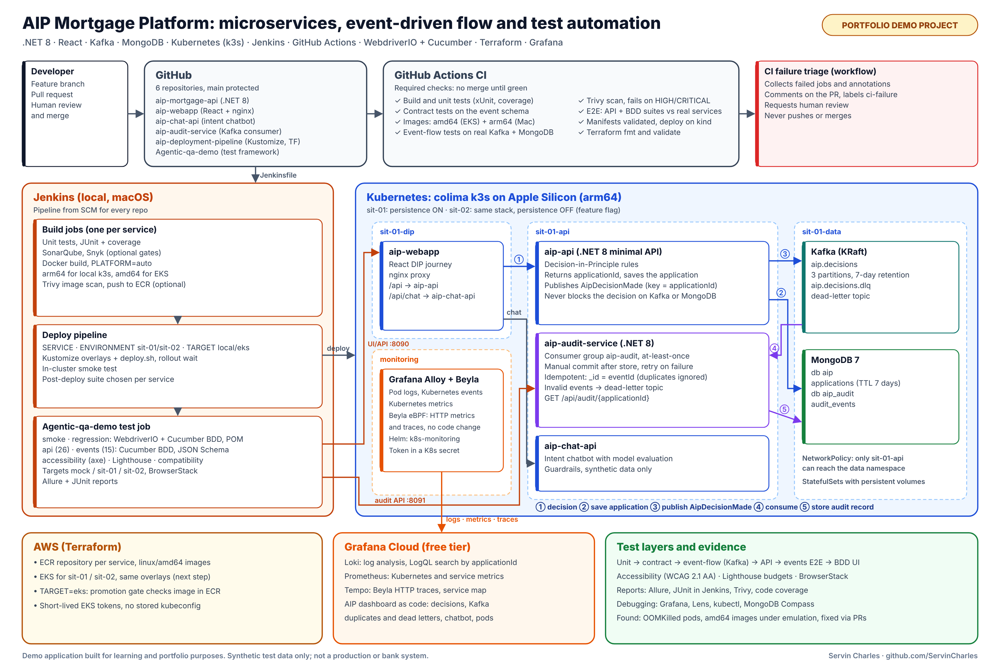
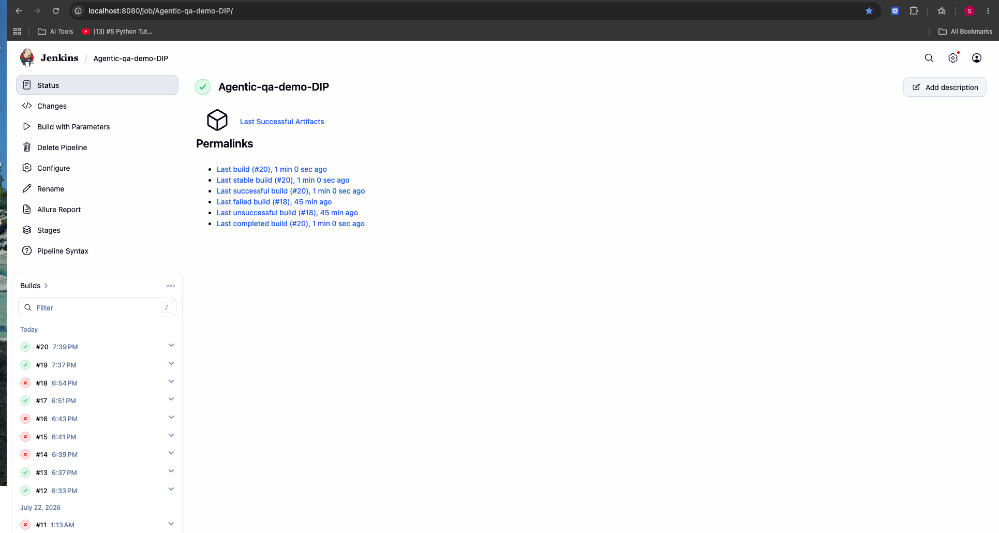
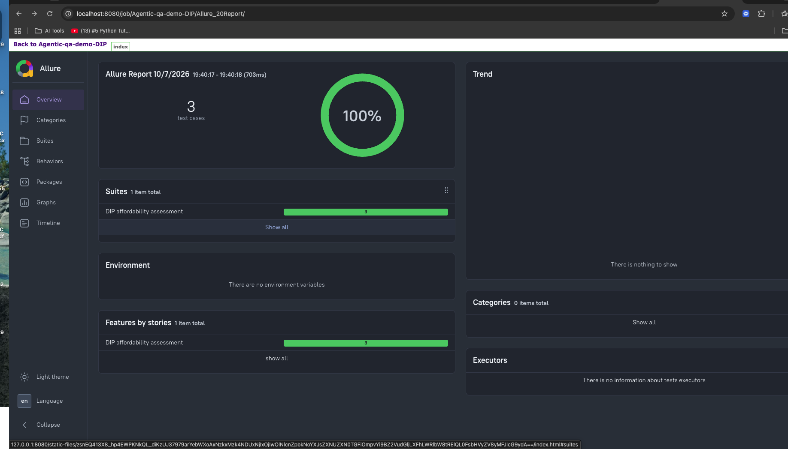
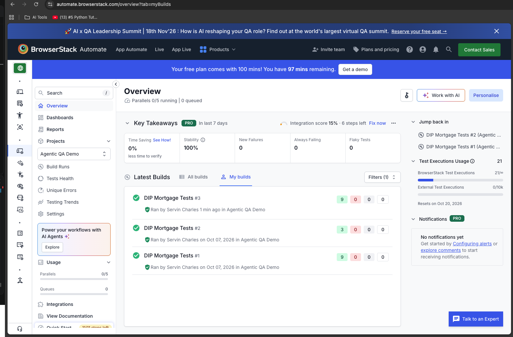
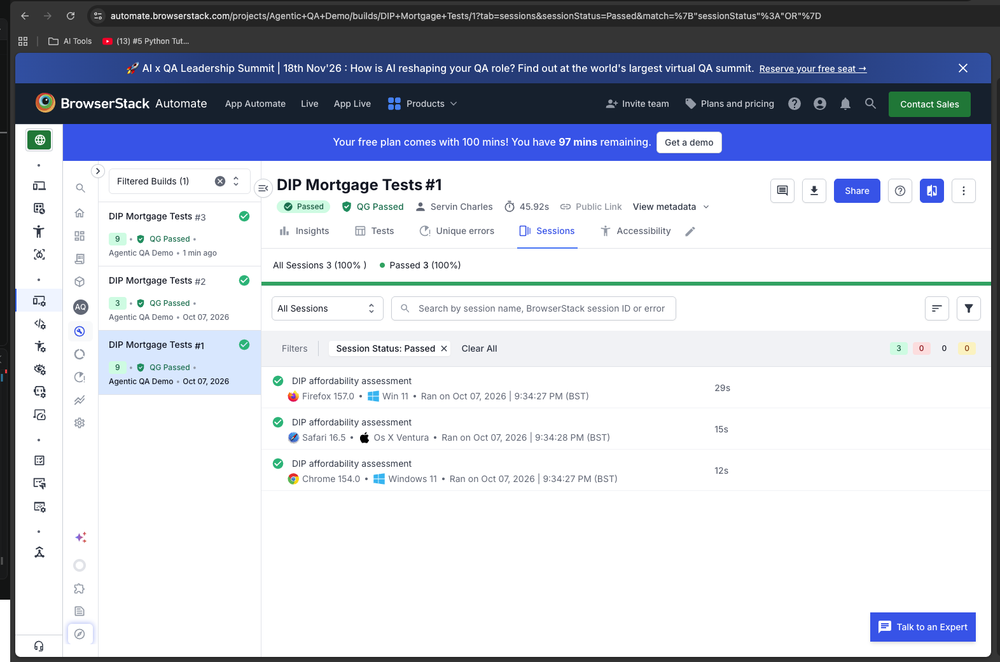

# Agentic QA Demo: test automation for a mortgage Decision-in-Principle journey

[](https://github.com/ServinCharles/Agentic-qa-demo/actions/workflows/smoke-tests.yml)
[](https://github.com/ServinCharles/Agentic-qa-demo/actions/workflows/aip-e2e.yml)

> **Portfolio demo project.** Built for learning and to show my test automation work. Synthetic test data only; this is not a production or bank system.

A test framework for a mortgage **Decision-in-Principle (DIP)** journey: BDD UI tests, API and event tests, accessibility checks, timing checks and cross-browser runs. It tests a local mock server, and a set of microservices (the **AIP platform**) running on Kubernetes, through GitHub Actions and Jenkins.



## What this project demonstrates

- **BDD with Page Object Model:** WebdriverIO 9 + Cucumber, locators kept out of step definitions
- **One BDD style for UI, API and events:** Cucumber throughout; the API and events features run without a browser and check contracts with JSON schemas (Ajv), using synthetic applicants from `test-data/`
- **Event-driven testing:** a decision is saved to MongoDB, published to Kafka and recorded by an audit service; the suite polls for the event instead of using fixed sleeps
- **Environment-aware CI:** the same suites run against `mock`, `sit-01` or `sit-02` (GitHub Actions and Jenkins), with a fail-fast reachability check
- **Real defects found by the tests:** on sit-01 the events suite failed 0/10 and led to two fixes in the platform: pods running out of memory (OOMKilled), and images built for the wrong CPU architecture
- **Cross-browser runs** on BrowserStack, **accessibility checks** with axe-core, **Allure and JUnit reports**
- **AI-assisted workflow:** written rules and agent instructions for Claude Code (`CLAUDE.md`, `.claude/`), plus a ticket-to-Gherkin generator that writes draft scenarios for human review

## Test suites

| Suite | Command | Tooling | What it checks |
| --- | --- | --- | --- |
| BDD smoke | `npm run test:smoke` | WebdriverIO + Cucumber | `@smoke` scenarios of the DIP journey |
| BDD regression | `npm run test:regression` | WebdriverIO + Cucumber | Accepted, Referred and Declined journeys |
| API | `npm run test:api` | Cucumber (no browser) + Ajv | 26 scenarios: decisions per applicant, response contract, validation, error format, malformed JSON, hostile IDs, response time, calculator |
| Events | `npm run test:events` | Cucumber (no browser) + Ajv | 15 scenarios: application saved, decision event audited exactly once, each outcome audited, hostile IDs on the audit trail |
| Accessibility | `npm run test:a11y` | axe-core | Automated WCAG 2.1 AA rules on the DIP page |
| Page performance | `npm run test:lighthouse` | Lighthouse CI | Budgets on the DIP page: performance, accessibility and best-practice scores, LCP, CLS and TBT (fails the build) |
| Timing | `npm run test:perf` | WebdriverIO | Quick browser timings of the journey against the mock server |
| Repeatability | `npm run test:stress` | WebdriverIO | The journey 5 times in a row, with timing variance |
| Cross-browser | `npm run test:bstack` | BrowserStack | Chrome, Firefox and Safari |

The API and events features write JUnit XML and an HTML report to `reports/`. Jenkins shows the JUnit results, archives the HTML report, and copies the JUnit results into the Allure report.

The API features also check robustness: malformed JSON, hostile IDs (NoSQL and SQL injection strings, path traversal, script tags, over-long IDs) must get a 400 with the standard `{ error, details }` body, never a 500, and key endpoints must answer within `MAX_RESPONSE_MS`.

### Page performance (Lighthouse CI)

`lighthouserc.js` runs Lighthouse 3 times on `BASE_URL/mortgages/decision-in-principle` (mobile, simulated slow 4G and CPU, Lighthouse's default) and checks the median run against budgets. Reports (HTML and JSON per run) go to `reports/lighthouse/`.

| Budget | Limit | On breach |
| --- | --- | --- |
| Performance, accessibility, best-practices scores | at least 90 | fails |
| Largest Contentful Paint (LCP) | 2.5 s | fails |
| Cumulative Layout Shift (CLS) | 0.1 | fails |
| Total Blocking Time (TBT) | 200 ms | fails |
| SEO score, First Contentful Paint (1.8 s) | | warning |
| Text compression, cache lifetimes, render-blocking resources, meta description | | warning |

Run it against the real web app (`BASE_URL=http://localhost:8090 npm run test:lighthouse` with a sit-01 port-forward); the mock server's page is a stand-in, so its numbers say little. Chrome is found automatically, or set `CHROME_PATH`. These are lab numbers for catching regressions against a budget, not real-user measurements.

The accessibility and timing checks are automated signals, not a compliance audit or a load test: axe-core finds a subset of WCAG issues, and the timings come from a local mock server.

## Quick start

Needs Node.js 20+ and Chrome.

```bash
npm install
node mock-server.js &        # the mock DIP app on http://localhost:3000
npm run test:smoke
npm run test:api
```

Or run the smoke, API, timing, repeatability and accessibility suites in one go (it starts and stops the mock server itself):

```bash
node run-all-tests.js
```

Allure report: `npm run test:smoke:report`, or `npm run report:view` after a run (serves it on http://localhost:5555).

## Testing the AIP microservices

`mock-server.js` is the default target. The same suites also run against the **AIP platform**, deployed by the [AIP Deployment Pipeline](https://github.com/ServinCharles/aip-deployment-pipeline). It has the same routes, `data-testid`s and API contract, so only `BASE_URL` changes.

| Repo | Service | Tech |
| --- | --- | --- |
| [aip-webapp](https://github.com/ServinCharles/aip-webapp) | `aip-webapp` | React on nginx |
| [aip-mortgage-api](https://github.com/ServinCharles/aip-mortgage-api) | `aip-api` | .NET 8 API, saves applications to MongoDB, publishes decision events to Kafka |
| [aip-audit-service](https://github.com/ServinCharles/aip-audit-service) | `aip-audit-service` | .NET 8 Kafka consumer, keeps the audit trail in MongoDB |
| [aip-chat-api](https://github.com/ServinCharles/aip-chat-api) | `aip-chat-api` | Intent chatbot |

The environments run on a local Kubernetes cluster (k3s on colima): **sit-01** with persistence on, **sit-02** with persistence off. Terraform for AWS (ECR and EKS) is in the deployment repo. After a deploy, the deployment pipeline can run this framework's Jenkins job against the new version (`api` for an API deploy, `events` for the audit service, `smoke` otherwise).

### With Docker Compose

```bash
# Clone the app repos next to this one, then:
docker compose up --build -d
BASE_URL=http://localhost:8090 npm run test:api
BASE_URL=http://localhost:8090 npm run test:regression
docker compose stop aip-api        # writes .NET code coverage to coverage/aip-api.e2e.cobertura.xml
```

Port 8090 is used because 3000 is the mock server and 8080 is Jenkins.

### On the local cluster (sit-01 / sit-02)

Inside the cluster the services aren't reachable from your Mac, so the tests go through `kubectl port-forward`. Start each one in its own terminal and leave it open:

```bash
kubectl -n sit-01-dip port-forward svc/aip-webapp 8090:80               # web app and API
kubectl -n sit-01-api port-forward svc/aip-audit-service 8091:8080      # audit service (events suite)
curl http://localhost:8090/healthz                                       # prints ok
```

Then run a suite, for example:

```bash
BASE_URL=http://localhost:8090 npm run test:smoke
BASE_URL=http://localhost:8090 AUDIT_URL=http://localhost:8091 npm run test:events
```

For sit-02 use the `sit-02-dip` and `sit-02-api` namespaces. A port-forward is tied to one pod, so restart it after every redeploy of that service.

| Symptom | Cause | Fix |
| --- | --- | --- |
| `ERR_CONNECTION_REFUSED`, or `curl: (7) Failed to connect to localhost port 8090` | The port-forward isn't running | Start it |
| `address already in use` | An old port-forward still holds the port | `lsof -nP -iTCP:8090 -sTCP:LISTEN`, then `kill` that PID |
| `502 Bad Gateway` from nginx | The web app is up but aip-api isn't | `kubectl get pods -n sit-01-api`, then check its logs |

### Events suite

[`decision-audit.feature`](api-tests/features/decision-audit.feature) checks the event-driven flow: aip-api saves each application and publishes an `AipDecisionMade` event to Kafka, and aip-audit-service records it.

| Test | Checks |
| --- | --- |
| Application ID | Every decision returns its own `applicationId` (`AIP-yyyyMMdd-XXXXXXXX`) |
| Application saved | `GET /api/applications/{id}` returns the same income, commitments, loan and decision |
| Not found / invalid | An unknown ID gives 404, a malformed ID gives 400 |
| Event audited | Polls `GET /api/audit/{id}` until the event appears, then checks it against the `AipDecisionMade` schema: `eventType`, `schemaVersion`, `decision`, and no income in the event |
| Exactly once | Keeps checking for 2 seconds that no duplicate event arrives |
| All outcomes | Accepted, Referred and Declined are each audited with the right decision |
| Rejected request | A rejected request gets no `applicationId`, so nothing is saved or audited |

It needs persistence switched on, so run it against `mock` or `sit-01`. Duplicate delivery, the dead-letter topic and restart catch-up need direct access to Kafka, so aip-audit-service tests those in its own pipeline.

## CI/CD

### GitHub Actions

| Workflow | When | What |
| --- | --- | --- |
| [Smoke tests](.github/workflows/smoke-tests.yml) | Every push, and after a merge to `main` | Starts the mock server, runs the smoke suite in headless Chrome, uploads Allure results |
| [AIP microservices E2E](.github/workflows/aip-e2e.yml) | Every push and pull request | Builds aip-api and aip-webapp from their repos, runs the API, BDD and Lighthouse suites against them, uploads .NET code coverage and the reports |
| CI failure triage | When either workflow fails | Comments the failed steps on the pull request (or opens an issue) and requests a human review; it never pushes or merges |

`main` is protected: changes go through a pull request, and the CI checks must pass before merging.

### Jenkins

The [Jenkinsfile](Jenkinsfile) installs dependencies, lints, starts the mock server when needed, runs the chosen suite, and publishes JUnit results and the Allure report.

- **Local Jenkins:** `brew install jenkins-lts && brew services start jenkins-lts`, then open http://localhost:8080.
- **Job:** Pipeline job, "Pipeline script from SCM", this repo, branch `main`, script path `Jenkinsfile`.
- **Needs:** plugins Pipeline, NodeJS, Credentials Binding, JUnit, HTML Publisher and Allure; a NodeJS tool named `NodeJS`; credentials `browserstack-user` and `browserstack-key`.

**Build with Parameters:**

| Parameter | Values | Purpose |
| --- | --- | --- |
| `TEST_SUITE` | `smoke`, `regression`, `api`, `events`, `lighthouse`, `all` | Which suite to run (`all` = smoke, regression and api) |
| `ENVIRONMENT` | `mock` (default), `sit-01`, `sit-02` | The mock server, or a deployed AIP environment |
| `BASE_URL` | empty, or a URL | Overrides the environment's URL, e.g. `http://localhost:8090` for a port-forward |
| `AUDIT_URL` | empty, or a URL | `events` only: the audit service. Empty = the mock for `mock`, `http://localhost:8091` for SIT |
| `BROWSER` | `local`, `browserstack` | Local Chrome or BrowserStack |
| `USE_DOCKER` | `false` (default), `true` | Run the tests in the Docker image from the [Dockerfile](Dockerfile) |

For `sit-01` and `sit-02`, set `BASE_URL` (for example `http://localhost:8090`), or define the Jenkins variables `SIT_01_URL` and `SIT_02_URL`.

### Docker

Runs the tests in a container with headless Chromium, so no local Chrome is needed:

```bash
docker build -t agentic-qa-demo .
docker run --rm -v "$PWD":/app -v /app/node_modules agentic-qa-demo \
  sh -c "npm ci && (node mock-server.js &) && sleep 3 && npm run test:smoke"
```

The Dockerfile sets `CHROME_BIN` and `CHROMEDRIVER_PATH`, and [wdio.conf.js](wdio.conf.js) then runs Chrome headless.

## Cross-browser (BrowserStack)

```bash
export BROWSERSTACK_USERNAME=...
export BROWSERSTACK_ACCESS_KEY=...
npm run test:bstack:smoke          # Chrome, Firefox and Safari
npm run test:bstack:regression
npm run test:compat                # wider matrix defined in wdio.compatibility.conf.js
```

Runs so far cover Chrome (Windows 11), Firefox (Windows 11) and Safari (macOS Ventura). `wdio.compatibility.conf.js` defines a larger matrix (Edge, older versions, iPhone and Pixel) that hasn't been run in full yet.

BrowserStack can't reach `localhost` directly: point `BASE_URL` at a publicly reachable test environment, or use BrowserStack Local.

## AI-assisted workflow

- **`CLAUDE.md`** holds the project rules an AI coding assistant follows here: Page Object Model, naming, tagging, synthetic data only.
- **`.claude/`** holds agent instructions (test writer, bug triage, regression prevention), task guides for feature files and step definitions, and pre-commit and post-test checklists.
- **Ticket to Gherkin:** `npm run generate:ticket -- ABC-123 --mock` turns a Jira ticket payload into a draft feature file. It currently uses rules and templates, not a language model. Drafts go to `AI-generated-features/`, tagged `@draft`, and don't run until a person reviews them and moves them into `features/`. [`abc-123.feature`](AI-generated-features/abc-123.feature) is a sample.
- **Optional Jira MCP:** copy `.vscode/mcp.json.example` to `.vscode/mcp.json`, add your Jira MCP server and credentials (see `.env.example`), then ask the assistant to create scenarios for a ticket.

## Configuration

| Variable | Default | Purpose |
| --- | --- | --- |
| `BASE_URL` | `http://localhost:3000` | Application under test |
| `AUDIT_URL` | same as `BASE_URL` | Audit service for the events suite |
| `EVENT_TIMEOUT_MS` | `15000` | How long the events suite waits for an event to be audited |
| `MAX_RESPONSE_MS` | `1000` | Response time limit in the API timing scenarios |
| `BROWSERSTACK_USERNAME`, `BROWSERSTACK_ACCESS_KEY` | | BrowserStack account |
| `JIRA_BASE_URL`, `JIRA_EMAIL`, `JIRA_API_TOKEN` | | Optional Jira MCP ticket fetch |

### Mock server endpoints

| Method | Path | Purpose |
| --- | --- | --- |
| GET | `/` | The DIP form |
| POST | `/api/mortgages/dip/decision` | Decision, returns an `applicationId` |
| POST | `/api/mortgages/dip/calculate-borrowing-power` | Affordability calculator |
| GET | `/api/applications/{id}` | A saved application |
| GET | `/api/audit/{id}` | The audit trail of an application |

```bash
curl -X POST http://localhost:3000/api/mortgages/dip/decision \
  -H "Content-Type: application/json" \
  -d '{"annualIncome": 45000, "loanAmount": 150000, "existingCommitments": 0}'
```

## Project structure

```
.
├── features/
│   ├── features/dip-eligibility.feature      # BDD scenarios
│   ├── step-definitions/dip-eligibility.steps.js
│   ├── pages/                                # page objects
│   └── Locators/                             # selectors used by the page objects
├── api-tests/                                # API and events BDD (Cucumber, no browser)
│   ├── features/                             # dip-decision-api.feature, decision-audit.feature
│   ├── step-definitions/                     # common, API and audit steps
│   └── support/                              # HTTP client, world (settings, polling), JSON schemas
├── cucumber.js                               # Cucumber profiles: api, events
├── a11y-test.js                              # accessibility checks (axe-core)
├── perf-test.js · perf-stress-test.js        # timing and repeatability checks
├── run-all-tests.js                          # runs the mock-server suites in one go
├── mock-server.js                            # mock DIP app on port 3000
├── wdio.conf.js                              # local WebdriverIO config
├── wdio.browserstack.conf.js                 # BrowserStack: Chrome, Firefox, Safari
├── wdio.compatibility.conf.js                # wider BrowserStack matrix
├── test-data/                                # synthetic applicants, mock Jira ticket
├── scripts/generate-ticket-gherkin.js        # ticket-to-Gherkin draft generator
├── AI-generated-features/                    # generated drafts, not run until reviewed
├── .claude/ · CLAUDE.md                      # AI assistant rules and agent instructions
├── .github/workflows/                        # GitHub Actions
├── Jenkinsfile · Dockerfile · docker-compose.yml
└── docs/                                     # images and a sample Allure report
```

## Architecture rules

1. **Page Object Model:** no selectors in step definitions. Locators live in `features/Locators/*.locators.js` and are used by `features/pages/*.page.js`.
2. **One page object per screen.** Shared components go in `features/pages/components/`.
3. **Thin step definitions:** orchestration only, assertions with `expect` from `@wdio/globals`.
4. **No `browser.pause()`** outside debugging. Use WebdriverIO's auto-wait or `waitForDisplayed`.
5. **No credentials, PII, card or account numbers** in the repo. Use `test-data/*.json` and environment variables.
6. **Every new page object** gets at least one `@smoke` scenario.
7. **Flaky tests** are quarantined with `@quarantine`, never silently deleted.

| Artefact | Convention | Example |
| --- | --- | --- |
| Feature files | `kebab-case.feature` | `dip-eligibility.feature` |
| Page objects | `camelCase.page.js` | `dipJourney.page.js` |
| Step definitions | Mirror the feature name | `dip-eligibility.steps.js` |
| Scenario titles | Start with a verb | `Accept an applicant within...` |

## Screenshots

A [sample Allure report](https://servincharles.github.io/Agentic-qa-demo/report/) from a mock-server run is published from `docs/report` (open it locally with `npx allure open docs/report`).

| Jenkins job | Allure report |
| --- | --- |
|  |  |

| BrowserStack builds | BrowserStack sessions (Chrome, Firefox, Safari) |
| --- | --- |
|  |  |

## Troubleshooting

| Problem | Fix |
| --- | --- |
| Mock server port 3000 in use | `lsof -nP -iTCP:3000 -sTCP:LISTEN`, `kill` that PID, then `node mock-server.js` |
| `ERR_CONNECTION_REFUSED` against the mock | Start it: `node mock-server.js` |
| BrowserStack runs fail | Check `BROWSERSTACK_USERNAME` and `BROWSERSTACK_ACCESS_KEY`, and that `BASE_URL` is reachable from BrowserStack |
| Allure viewer port 5555 in use | `lsof -nP -iTCP:5555 -sTCP:LISTEN`, `kill` that PID, then `npm run report:view` |
| Jenkins: `docker: command not found` | Install and start colima, then `brew services restart jenkins-lts` |
| Jenkins login | The initial password is in `~/.jenkins/secrets/initialAdminPassword` |
| Dependencies won't install | `npm cache clean --force`, delete `node_modules`, then `npm ci` |

## Security

- Secrets come from environment variables or the CI credential store, never from the repo.
- Test data is synthetic: no real names, PII, card numbers or sort codes.

## Resources

[WebdriverIO](https://webdriver.io/) · [Cucumber / Gherkin](https://cucumber.io/docs/gherkin/) · [axe-core](https://www.deque.com/axe/) · [BrowserStack](https://www.browserstack.com/docs) · [Allure](https://allurereport.org/docs/)
